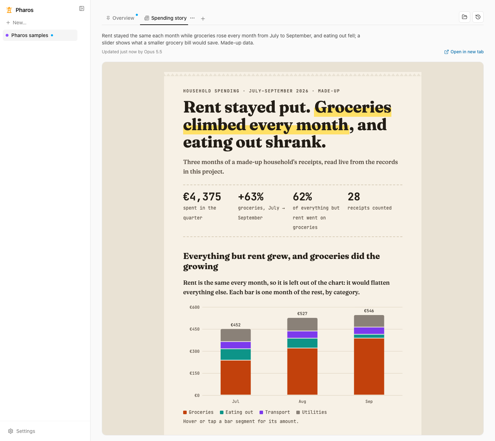

# Pharos

**Your AI agents keep the project. Pharos shows it to you as pages, not paragraphs.**

Pharos is a local, open-source project workspace for people who run projects with AI agents
(Claude Code, Codex, Cursor and other MCP clients). The agent stores the project as structured
data over [MCP](https://modelcontextprotocol.io), then explains it with **views** built from that
data: boards of project-management components, report documents, or whole report pages. You read
them in a web app that updates live as the agent works, and when you ask a question, the agent
answers with a view instead of another wall of text.

- Website: <https://pharos.zuboto.com>
- Status: **v0.2.0, early development.** APIs and saved-view formats may still change. See the
  [release notes](CHANGELOG.md) and [roadmap](docs/PLAN.md).
- License: [MIT](LICENSE)



_A report page an agent wrote from made-up spending records. Its numbers and chart are read live
from the project's data each time it loads._

## Contents

- [Why Pharos](#why-pharos)
- [How it works](#how-it-works)
- [Key concepts](#key-concepts)
- [Quick start](#quick-start)
- [Connect your agent](#connect-your-agent)
- [For AI agents](#for-ai-agents)
- [Answering questions from the web app](#answering-questions-from-the-web-app)
- [Reports](#reports)
- [Keep it running (macOS)](#keep-it-running-macos)
- [Configuration](#configuration)
- [Troubleshooting](#troubleshooting)
- [Works with](#works-with)
- [Repository layout](#repository-layout)
- [Development](#development)
- [Documentation map](#documentation-map)

## Why Pharos

Agents now run large, long-lived projects, and both the person and the agent drown in prose:
plans, status updates, task lists and explanations all arrive as text. Fixed tools (Jira, Linear)
force one framework onto every project; flexible tools (Notion, whiteboards) are hard for an agent
to read, produce or keep current.

Pharos takes a different route:

1. **Structured data first, UI second.** Goals, stages, tasks, decisions and records are the
   source of truth. Views are drawn over them, so changing a task updates every page that shows it.
2. **Compose, don't draw.** Agents build views from a typed catalog of components (JSON specs),
   which keeps them consistent, safe and editable. A whole bespoke HTML page is the exception, not
   the rule.
3. **Agent-agnostic.** Any MCP-capable agent can read and write projects and build views.
4. **Less reading, more seeing.** Every feature should cut the text a person reads to know where
   a project stands.
5. **Local-first.** Everything runs on your machine, in one SQLite file. No account, no cloud.
   Every change is a revision you can inspect and revert.

More in [`docs/OVERVIEW.md`](docs/OVERVIEW.md).

## How it works

```
 ┌───────────────┐   MCP tools    ┌────────────────────────────────┐
 │  AI agent     │ ─────────────▶ │  Pharos server (127.0.0.1:4300) │
 │  Claude Code, │                │  · project data + history       │
 │  Codex,       │ ◀───────────── │    (SQLite, every write a        │
 │  Cursor, …    │    results     │     revision)                   │
 └───────▲───────┘                │  · views, catalog, checks        │
         │ answers questions      │  · REST /api, MCP /mcp, SSE feed │
         │ (optional, automatic)  └───────────────┬────────────────┘
         │                                        │ HTTP + live events
 ┌───────┴────────────────────────────────────────▼────────────────┐
 │  Pharos web app (localhost:5173 in dev, or served by the server) │
 │  renders views live; you read, edit, act, undo and ask questions │
 └──────────────────────────────────────────────────────────────────┘
```

1. You connect your agent to Pharos over MCP and ask it to set up or update a project.
2. The agent writes structured data (`apply`) and builds views (`view_create`), checking them
   first with `view_preview`.
3. The web app shows the views and reloads whatever changed, live.
4. You ask a question from any widget. If Claude Code is installed, Pharos runs it to answer, and
   the answer arrives as a new view.

## Key concepts

| Concept             | What it is                                                                                                                                                                                  |
| ------------------- | ------------------------------------------------------------------------------------------------------------------------------------------------------------------------------------------- |
| **Project**         | The container for everything below. Each project has its own option lists (task statuses, priorities and so on).                                                                            |
| **Entities**        | Typed project data: goals, stages, tasks, artifacts, decisions, records (money, dates, text), claims, terms, files and questions. Defined once in `packages/schema/src/entities.ts`.        |
| **Revision**        | Every write is one revision with before/after snapshots and a message saying why. Anything can be inspected, diffed and reverted.                                                           |
| **View**            | A page about the project. It is one of three kinds: a board, a report document or a report page.                                                                                            |
| **Board**           | A grid of catalog components (stage tracker, timeline, kanban, goal tree, table, charts, stat cards, decision block, gallery, …). Each reads data through a query, never a copied snapshot. |
| **Report document** | Blocks in reading order (text with live values, charts, tables, figures, steps, sheets, drawings, embeds) that Pharos lays out in its own style. The default for a report.                  |
| **Report page**     | A whole HTML page an agent wrote, for a story that needs its own look. Runs in a locked frame and reads data only through `window.pharos`.                                                  |
| **Question (ask)**  | A question you ask from a widget or page. An agent answers with a view, or changes one block when you ask about that block.                                                                 |
| **Action**          | A button on a page ("Log a service", "Mark paid") with a form generated from the record type. Each submission is one revision you can undo.                                                 |
| **Freshness**       | Pharos tracks what each agent-built view read. When that data changes, the view is marked out of date, and "Ask to refresh" has the agent rewrite it.                                       |
| **Files**           | Folders you add in Settings. Files stay on your disk, read-only; agents see only file details, never contents.                                                                              |
| **Packs**           | Ready-made project starters (car, money, music, study, company documents) with record types and pages.                                                                                      |

## Quick start

**Requirements**

- Node.js 24 recommended (`.node-version`); 22.13+, 24.x and 26+ are supported (not 23.x or
  25.x). Pharos uses the built-in `node:sqlite`.
- pnpm 12.9.1. Without pnpm installed, replace `pnpm` with `npx pnpm@12.9.1` in the commands below
  (for example, `npx pnpm@12.9.1 install --frozen-lockfile`).
- An MCP client for your agent, such as Claude Code, Codex, Cursor or Claude Desktop.

**Run it**

```sh
git clone https://github.com/zuboto-dev/pharos.git
cd pharos
pnpm install --frozen-lockfile
pnpm dev
```

`pnpm dev` starts:

- the server on <http://localhost:4300> (REST under `/api`, MCP at `/mcp`)
- the web app on <http://localhost:5173>

Open the web app and create a project (or start from a pack), or connect your agent and ask it to
set one up.

If Claude Code is installed, asking a question in the web app starts an agent automatically. To
start with automatic answering disabled, run `PHAROS_AGENT_COMMAND=off pnpm dev` in a POSIX shell.
You can also pause answering in **Settings**; a pause is saved in the database and survives
restarts. The automatic runner uses a POSIX shell, so on Windows use WSL for that workflow.

**See samples** (optional). With the server running, install sample projects and views made from
made-up data:

```sh
node samples/install/install-samples.mjs --url http://127.0.0.1:4300
```

It asks once for access to `samples/files/` (approve it in the web app, then run it again).

## Connect your agent

The server must be running for the HTTP connection.

**Claude Code**

```sh
claude mcp add --transport http pharos http://localhost:4300/mcp
```

**Codex**

```sh
codex mcp add pharos --url http://localhost:4300/mcp
```

or in `~/.codex/config.toml`:

```toml
[mcp_servers.pharos]
url = "http://localhost:4300/mcp"
```

For non-interactive runs (`codex exec`), which can't ask you to approve a tool call, the tested
runs approved Pharos's tools per run with
`-c 'mcp_servers.pharos.default_tools_approval_mode="approve"'`.

**Cursor** (`~/.cursor/mcp.json`) and other clients that support streamable HTTP

```json
{
  "mcpServers": {
    "pharos": { "url": "http://localhost:4300/mcp" }
  }
}
```

**Clients that need stdio** (for example Claude Desktop). Run `pnpm build` once, then:

```json
{
  "mcpServers": {
    "pharos": {
      "command": "node",
      "args": ["/path/to/pharos/apps/server/dist/stdio.js"]
    }
  }
}
```

The stdio process shares the web server's database only if both resolve the same path: set the
same `PHAROS_DB` (an absolute path) in the client's `env` if the server doesn't use the default.
Its changes are found by polling about once a second, so the web app shows them within a few
seconds.

Then try asking your agent:

- "Set up a project in Pharos for this repo from its docs: goals, scope, stages, and tasks."
- "What's blocking the current stage? Answer with a Pharos view."
- "Write a Pharos report on what changed this week."
- "Mark the README task done in Pharos."

## For AI agents

This section is for an agent reading this repository. There are two different jobs; work out
which one you have.

### Using Pharos (you are connected to it over MCP)

The server explains itself: its MCP instructions and `report_guide` carry the full rules, the
catalog and worked examples. The short version:

1. Start with `project_snapshot` (or `list` with `type: "project"` to find the project). It also
   tells you how many changes people made since you last looked; `changes_since` lists them.
2. Change data only with `apply`, and give every change a `message` saying why. Each call is one
   revision; `history_list`, `history_diff` and `history_revert` work with them.
3. Build views from the catalog (`catalog_list`, `catalog_describe`). Check a draft with
   `view_preview`, then save with `view_create` or `view_update` (pass `expectedRevision`).
   Components read data through queries; never copy rows into a view.
4. For a report, prefer a **report document** (`doc`). Write a whole **report page** (`page`, HTML)
   only for a bespoke design. Read `report_guide` first; upload pictures, fonts and scripts with
   `report_asset_put`.
5. Answer open questions with `view_answer`. While a block ask is open, change only that block.
6. Never compare option values (task status and so on) to built-in names; projects can rename
   them. Agents can't add, move or remove project files, or read their contents.

| Area       | Tools                                                                                                                                   |
| ---------- | --------------------------------------------------------------------------------------------------------------------------------------- |
| Read data  | `project_snapshot`, `list`, `get`, `changes_since`                                                                                      |
| Write data | `apply`, `action_run`, `pack_list`, `pack_apply`                                                                                        |
| History    | `history_list`, `history_diff`, `history_revert`                                                                                        |
| Views      | `catalog_list`, `catalog_describe`, `view_list`, `view_get`, `view_preview`, `view_create`, `view_update`, `view_delete`, `view_answer` |
| Reports    | `report_guide`, `report_asset_put`, `report_asset_list`                                                                                 |

Without MCP, the same writes go to `POST /api/apply` with an `x-pharos-author: agent:<name>` header.
That header declares a role; it is not authentication.

### Working on Pharos (you are changing this code)

Read [`CLAUDE.md`](CLAUDE.md) first: it is the map for agents working on this repository, with
the layout, the rules every change must follow (all writes through `Store.apply`, new SQLite
changes as new migrations, how to add a catalog component, how freshness and report pages work)
and every command. [`CONTRIBUTING.md`](CONTRIBUTING.md) covers the pull request workflow.
Run `pnpm typecheck`, `pnpm lint`, `pnpm test` and `pnpm format:check` before you push.

## Answering questions from the web app

Use **Ask** on any widget or item to send your agent a question. If Claude Code (`claude`) is
installed, the server answers new questions automatically: it runs Claude Code connected only to
Pharos, and the answer shows up as a new view. Automatic answers use your agent account and its
usage. You can pause it, or answer questions that waited, under **Settings** (bottom of the
sidebar).

| Setting                               | Effect                                             |
| ------------------------------------- | -------------------------------------------------- |
| _(not set)_                           | Claude Code answers, if it is installed            |
| `PHAROS_AGENT_COMMAND='your command'` | Runs your command instead                          |
| `PHAROS_AGENT_COMMAND=off`            | Off; your agent sees open questions when it checks |

A custom command receives `PHAROS_PROMPT` (the questions plus the view guidelines, catalog and
examples, ready to pass to an agent), `PHAROS_PROJECT_IDS`, `PHAROS_REQUEST_IDS` and `PHAROS_URL`
in its environment. Output goes to `~/.pharos/agent.log`. Only one run happens at a time.

## Reports

Boards are good for the state of a project. For a story (what happened, why, what to decide),
an agent writes a report:

- **Report document** (the default). The agent writes blocks in reading order: text with live
  values, stats, charts, tables, figures with pictures, steps, collapsible details, review sheets
  with decisions, and, where nothing else fits, a `drawing` (a small HTML section) or an `embed`
  (another https site). Pharos owns the typography, spacing, light and dark themes and the phone
  layout, so any agent gets a well-set report. Contract:
  [`docs/reframe/r14-report-documents.md`](docs/reframe/r14-report-documents.md) and
  [`r15-review-documents.md`](docs/reframe/r15-review-documents.md).
- **Report page.** A whole HTML document an agent wrote, with its own look and interactive parts.
  It runs in a locked frame (no network, no popups, can't leave its frame; links open through
  Pharos) and gets data only through `window.pharos`: `pharos.data(name)` resolves to the rows of
  a named read, `pharos.onData` and `pharos.onTheme` call back when data or the theme changes, and
  `pharos.openFile` and `pharos.openLink` ask Pharos to open a project file or a web address.
  Contract: [`docs/reframe/r13-report-pages.md`](docs/reframe/r13-report-pages.md).

Both keep every version and are marked out of date when the data they read changes; **Ask to
refresh** has the answering agent rewrite them from fresh data.

## Keep it running (macOS)

`pnpm dev` only lives as long as its terminal. To keep Pharos available for your agents, run the
built app as a launchd service:

```sh
pnpm service install
```

That builds your local `main` in a copy of its own (`~/.pharos/app`, so edits in your checkout
never affect it), then starts the server at <http://localhost:4300>, which also serves the web
app, at login and restarts it if it exits. Its log is `~/.pharos/server.log`. Use
`pnpm service status`, `stop`, `start`, `restart`, `log` and `uninstall` to manage it.

It also keeps itself up to date: whenever `main` moves (a commit, merge or pull), it builds the
new `main` in a second copy, backs up the database to `~/.pharos/backups` (the last 5 are kept),
switches to it and restarts, and goes back to the previous version if the new one doesn't start.
A build that fails leaves the running version alone, and it waits while an agent is answering a
question. `~/.pharos/update.log` says what it did; `pnpm service autoupdate off` stops it, and
`pnpm service update` deploys `main` by hand. `install` stores only `PORT`, `PHAROS_DB`,
`PHAROS_AGENT_COMMAND`, `PHAROS_AGENT_LOG` and `PHAROS_WEB_URL` from its environment (any other
variable your command needs must be set by the command itself), and links that agents share point
at the service's own address unless `PHAROS_WEB_URL` says otherwise. Stop the service before
`pnpm dev`, since both listen on port 4300.

On other systems, run `pnpm build` and then `pnpm --filter @pharos/server start` under your own
supervisor; the built server serves the web app too.

## Configuration

| Variable               | Default                  | Purpose                                                 |
| ---------------------- | ------------------------ | ------------------------------------------------------- |
| `PHAROS_DB`            | `~/.pharos/pharos.db`    | Database file                                           |
| `PORT`                 | `4300`                   | Server port                                             |
| `PHAROS_WEB_URL`       | `http://localhost:5173`  | Web app address in shared links (built server: its own) |
| `PHAROS_SERVER_URL`    | `http://localhost:4300`  | Server the web app's dev proxy talks to                 |
| `PHAROS_AGENT_COMMAND` | Claude Code if installed | Command that answers questions (`off` disables)         |
| `PHAROS_AGENT_LOG`     | `~/.pharos/agent.log`    | Log for that command                                    |

Set these in the environment before starting Pharos; it does not load a root `.env` file. The
server only accepts requests from localhost, plus the host of a non-local `PHAROS_WEB_URL` (a
tunnel with a login in front, see SECURITY.md). **Keep the web app and server local: v0.2 has no
authentication.** See [SECURITY.md](SECURITY.md) for the trust model and vulnerability reporting.

## Troubleshooting

- **"Port 4300 is already in use"**: Pharos (maybe the service, see `pnpm service status`) is
  already running. Stop it, or start this one with another `PORT`. With `pnpm dev`, also set
  `PHAROS_SERVER_URL` so the web app's proxy follows, for example
  `PORT=4400 PHAROS_SERVER_URL=http://localhost:4400 pnpm dev`. The web app stays on 5173, or the
  next free port if that is taken. Update the MCP URL your agent uses to match.
- **The agent can't connect**: the HTTP server must be running at the URL you registered. A stdio
  client starts its own process and uses the database that process resolves, so a project that
  seems to be missing usually means a different `PHAROS_DB`.
- **Questions aren't answered**: **Settings** shows why. Answering is off with
  `PHAROS_AGENT_COMMAND=off`, unavailable when Claude Code isn't installed (install it or set your
  own command), or paused (resume it there). The command's output is in `~/.pharos/agent.log` (or
  `PHAROS_AGENT_LOG`); the service's own log is `~/.pharos/server.log`.
- **Changes from another process don't appear**: the web app reloads on a server event, and
  changes written by another process (stdio) are noticed by polling about once a second. Reload
  the page if the live connection was interrupted.

## Works with

Each agent below passed the compatibility scenarios in [`eval/compat`](eval/compat), connected
over MCP only to an isolated Pharos server: set up a project from a brief, mark a task done,
answer a question with a checked view, start from a pack and add a record, ask for a folder and
wait for the owner, and (since 2026-10-20) answer an explain-and-compare question with a report
document.

| Agent       | Tested version                  | Date       | Result                         |
| ----------- | ------------------------------- | ---------- | ------------------------------ |
| Claude Code | 2.1.304 (its default model)     | 2026-10-20 | 6/6 passed                     |
| Codex       | codex-cli 0.162.1 (gpt-6.1-sol) | 2026-10-14 | 5/5 passed (the five of 10-14) |
| OpenCode    | —                               | —          | planned                        |

To run them yourself, start a separate server on its own port and database with answering off,
then point the runner at it (it refuses port 4300, so your own data is never touched; each
scenario is one agent run and uses that agent's usage):

```sh
PORT=4391 PHAROS_DB=/tmp/pharos-compat.db PHAROS_AGENT_COMMAND=off \
  PHAROS_AGENT_LOG=/tmp/pharos-compat-agent.log pnpm --filter @pharos/server dev
node eval/compat/run.mjs --agent claude --url http://127.0.0.1:4391   # or --agent codex
```

It prints a pass/fail table and writes the results (with each run's output) under
`eval/results/compat`.

## Repository layout

A pnpm workspace in TypeScript.

```
packages/schema/     Zod schemas shared by server and web: the single source of types
  src/entities.ts      entity types, fields, defaults and references
  src/options.ts       default option lists (statuses, priorities, …)
  src/views/           catalog props, boards, report documents and pages, query language, reads
  src/packs/           ready-made project packs
apps/server/         Hono on 127.0.0.1:4300: REST /api, MCP /mcp (HTTP) and stdio (src/stdio.ts)
  src/store/           SQLite store: migrations, apply/revert/history, project_snapshot
  src/mcp.ts           MCP tools and the instructions agents see
  src/guidance.ts      guidance and examples given to agents (report_guide, answer brief)
  src/views/           view service, catalog, previews/checks, freshness, report routes and bridge
  src/actions/         page actions
  src/files/           project folders and files (read-only)
  src/agent-runner.ts  runs the answering agent for new questions
  src/feed.ts          live events (SSE) for the web app
apps/web/            Vite + React + Tailwind web app on :5173 (proxies /api to the server)
  src/catalog/         view renderer and one React component per catalog entry
  src/pages/           project list, project page, documents, report frames, settings
eval/                agent compatibility scenarios and end-to-end report checks
samples/             made-up sample data and the sample installer
scripts/             the macOS service script and helpers
docs/                overview, scope, plan, design notes (docs/reframe/)
```

## Development

```sh
pnpm typecheck
pnpm lint
pnpm test
pnpm build
pnpm format:check
```

Use `pnpm format` to apply formatting fixes. CI runs these checks on pushes and pull requests.
`@pharos/schema` exports `src/` in development and `dist/` otherwise, so run `pnpm build` before
`pnpm --filter @pharos/server start`. See [CONTRIBUTING.md](CONTRIBUTING.md) for adding
components and views and submitting a pull request.

## Documentation map

| Read this                              | For                                                      |
| -------------------------------------- | -------------------------------------------------------- |
| [`docs/OVERVIEW.md`](docs/OVERVIEW.md) | The problem, the idea, principles and key decisions      |
| [`docs/SCOPE.md`](docs/SCOPE.md)       | What the first version includes and leaves out           |
| [`docs/PLAN.md`](docs/PLAN.md)         | Stack, architecture and milestones                       |
| [`docs/reframe/`](docs/reframe)        | Design notes and contracts for each feature (R10 to R15) |
| [`CLAUDE.md`](CLAUDE.md)               | The working map for agents changing this code            |
| [`CHANGELOG.md`](CHANGELOG.md)         | What each release added                                  |
| [`SECURITY.md`](SECURITY.md)           | Trust model and how to report a vulnerability            |
| [`CONTRIBUTING.md`](CONTRIBUTING.md)   | Development setup and pull requests                      |

## Community and license

Use the repository's bug report or feature request template for feedback. Participants follow
the [code of conduct](CODE_OF_CONDUCT.md). Pharos is available under the [MIT License](LICENSE).
